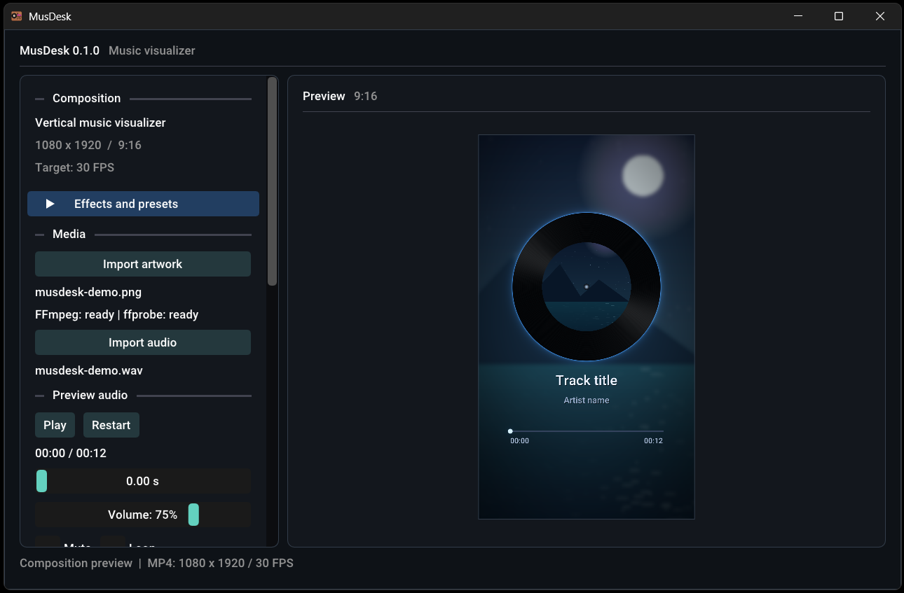
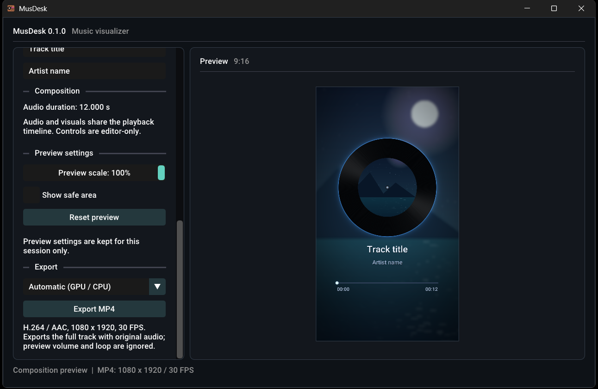

# MusDesk

**MusDesk** is a desktop tool for turning a music track and cover artwork into a vertical, animated music visualizer video for short-form platforms.

> **Version 0.1.0.** A Windows music visualizer with artwork/audio import, editable presets and 1080 × 1920 / 30 FPS H.264/AAC export. MusDesk's own source code is licensed under MIT. **The application interface currently supports English only.**

## Download and first run

1. For the owner's personal private release, download
   `MusDesk-0.1.0-private-windows-x64.zip` from the repository's
   [Releases](https://github.com/Kroer333/MusDesk/releases) page. Extract the entire folder;
   FFmpeg and ffprobe are already included beside `MusDesk.exe`.
2. Start `MusDesk.exe`. The Media panel should report
   **FFmpeg: ready | ffprobe: ready**. Import artwork and audio, adjust the labels,
   then use **Export MP4**. Keep the assets and DLLs from the ZIP together.

The private release is intended for personal use in a private repository;
see `PRIVATE_PACKAGE.txt` inside that archive. GitHub releases inherit repository
access: the repository must actually be private to restrict access to its releases.
No repository visibility or release is changed by building a ZIP.

The alternative `MusDesk-0.1.0-windows-x64.zip` omits the external tools. For that
variant, obtain a Windows x64 FFmpeg build using the Windows links on the official
   [FFmpeg download page](https://ffmpeg.org/download.html). Use a build containing
   `ffmpeg.exe`, `ffprobe.exe`, `libx264` and AAC support. Extract its archive too.
Copy **both** `ffmpeg.exe` and `ffprobe.exe` from its `bin` folder into the
   extracted MusDesk folder, alongside `MusDesk.exe`. Existing installations can
   also be supplied through `MUSDESK_FFMPEG_DIR` or `PATH`.
Restart MusDesk after adding the tools.

FFmpeg tools are not included in the public MusDesk ZIP. Without them you can
edit artwork and visual effects, but audio import and MP4 export are unavailable.
Keep the assets and DLLs from the ZIP together. Visual Studio is not required
to run the extracted application.

See [release notes](RELEASE_NOTES.md) for limitations and
[publishing instructions](https://github.com/Kroer333/MusDesk/blob/main/RELEASING.md)
for the maintainer's publishing steps.

## Build a release ZIP

Build and package from a Visual Studio Developer PowerShell:

```powershell
cmake -S . -B build -G "Visual Studio 17 2022" -A x64 -DMUSDESK_PACKAGE_MEDIA_TOOLS=ON
cmake --build build --config Release --parallel 1 -- /nr:false
ctest --test-dir build -C Release --output-on-failure
cpack --config build/CPackConfig.cmake -C Release -D CPACK_PACKAGE_CHECKSUM=SHA256
```

The ZIP and checksum are placed in `build/packages`. Extract the entire folder
to a writable local directory and run `MusDesk.exe`; keep `SDL3.dll`, the MSVC
runtime DLLs and `assets/Roboto-Medium.ttf` alongside it. Windows 10/11 x64 with
an OpenGL 3.3 driver is required. Source archives are not configured; the binary
ZIP uses an explicit file list and includes no imported media or exports.

The CMake option defaults to OFF. The command above explicitly includes the
already installed tools for the **personal private package**.
This requires both tools and `tools/ffmpeg/LICENSE` (or
`-DMUSDESK_FFMPEG_LICENSE_FILE="path/to/the/build/LICENSE"`) and matching build/source
information in `tools/ffmpeg/README.txt` (or `MUSDESK_FFMPEG_BUILD_INFO_FILE`). Without packaged
tools, place independently obtained FFmpeg/ffprobe beside the EXE or use the
runtime search described below. Do not treat the local-tools option as a public
redistribution workflow; see [third-party notices](THIRD_PARTY_NOTICES.md).
The tools-free archive ends in `-windows-x64.zip`; the personal private archive
ends in `-private-windows-x64.zip`. The old `-local-win64.zip` is a legacy artifact.

`MusDesk.exe --version` prints the version without opening a window;
`MusDesk.exe --help` lists supported startup options. Build Release before
packaging: installation deliberately rejects Debug builds. This machine's
working package does not establish compatibility with a clean Windows machine.

The supplied MusDesk icon is embedded in the Windows EXE, together with version
metadata, and loaded from `assets/MusDesk.png` for the SDL window. Keep that PNG
inside the packaged assets directory.

## Features

1. Import a music track (MP3, WAV, or OGG) and cover artwork (PNG, JPEG, or WebP).
2. Display a spinning vinyl record with centered artwork, a blurred image background, track title, artist, and progress timer.
3. Animate a glow/ring using energy, bass hits and FFT bands, with editable presets.
4. Preview and export synchronized MP4 video in portrait, landscape or square layouts.

### Original 0.1.0 target (MVP)

- One vertical format: **1080 × 1920**, **30 FPS**, **9:16**.
- One layout, including a rotating vinyl record and audio-reactive glow.
- Basic controls for rotation speed, glow strength, and background motion.
- Preset configuration stored as JSON.
- H.264 video with AAC audio in an MP4 container.
- Consistent preview and export, with visuals calculated from an explicit playback timestamp.

This is **not** a general-purpose video editor.

## Build and run on Windows

Requirements: Visual Studio 2022 with the **Desktop development with C++** workload,
a Windows SDK, CMake 3.21 or newer, and a graphics driver supporting **OpenGL 3.3 Core**.
Run these commands from the repository root
in a Developer PowerShell for Visual Studio:

```powershell
cmake -S . -B build -G "Visual Studio 17 2022" -A x64
cmake --build build --config Debug --parallel 1 -- /nr:false
ctest --test-dir build -C Debug --output-on-failure
.\build\Debug\MusDesk.exe
```

Alternatively, open the repository with **File > Open > Folder** in Visual Studio,
build the Debug configuration, and select `MusDesk.exe` as the startup target.

CMake downloads pinned SDL **3.4.18**, Dear ImGui **1.93.0**, stb, libwebp
**1.6.0** and nlohmann/json **3.12.0** source archives from their official GitHub repositories and verifies
their SHA-256 checksums. stb decodes PNG/JPEG and rasterizes text; libwebp provides
the WebP decoder. Encoder tools are not built.
The first configuration needs internet access; sources and build products stay
inside the build directory. SDL's DLL and the `assets/Roboto-Medium.ttf` font
are copied next to `MusDesk.exe`; the remaining libraries are linked statically.
Keep the DLL and the assets directory alongside the executable when running it elsewhere.

The requested client size is 1280 × 800, with a minimum of 900 × 600. Desktop
scaling and window-manager constraints can affect physical size. Close the window
with the title-bar close button or **Alt+F4**. Preview rendering uses VSync when available,
a frame delay otherwise, and pauses while minimized; export rendering runs independently. Diagnostic messages go to
the console; startup failures produce a nonzero exit code.

## Current workspace

### Projects (development)

Choose format and resolution under **Composition**. Landscape layouts put the
vinyl on the left and labels/timeline on the right; square and portrait layouts
remain centered.

| Format | 720 px short edge | 1080 px short edge |
| --- | --- | --- |
| 9:16 | 720 × 1280 | 1080 × 1920 |
| 16:9 | 1280 × 720 | 1920 × 1080 |
| 1:1 | 720 × 720 | 1080 × 1080 |
| 3:4 | 720 × 960 | 1080 × 1440 |
| 4:3 | 960 × 720 | 1440 × 1080 |

Preview uses the chosen aspect ratio; MP4 uses the chosen pixel dimensions at
30 FPS. The 720 px option renders fewer pixels and can reduce export cost.
Output size is independent of window size and preview scale. Format/resolution
changes mark the project unsaved and survive Save, recovery and Collect project.
New projects default to 1080 × 1920. Version 1 projects reopen at that size;
new project saves use version 3 with format, short-edge resolution and artwork
framing. Versions 1 and 2 retain their previous centered crops and softness.

The editor's **Project** section provides **New**, **Open**, **Save** and
**Save As**. Shortcuts are Ctrl+N, Ctrl+O, Ctrl+S and Ctrl+Shift+S. You can also
drop a `.musdesk` file or start with `MusDesk.exe --project "path/to/project.musdesk"`.
The project startup option is exclusive with `--artwork`, `--audio` and `--preset`.

Projects are versioned, readable JSON files containing track labels, all visual
preset values, media references, duration and the saved preview position.
They reopen paused. Audio samples and artwork are not embedded: media paths
are stored relative to the project where possible. Move the project together
with its referenced folders to keep those paths valid. **Save As** recalculates
references for the new project folder. Files on another drive use absolute paths.

Unavailable or damaged media are identified with **Locate artwork** / **Locate
audio** buttons; other project settings remain editable. Point to replacement
files, then save the project. Opening another project clears the previous
composition's media, so missing files cannot silently reuse an old image or song.
A malformed project leaves the current composition unchanged.

An asterisk marks unsaved composition changes. Opening/new/closing prompts to
save, discard or cancel; cancelling a save dialog or a failed save does not
continue the destructive action. Moving the playhead alone does not mark the
composition dirty, but its current position is included when you save.
Writes use an exclusive temporary file and replace the destination only after
writing successfully. Import/export must finish or be cancelled before project
opening or saving. Volume, mute, loop and preview-only guides/scale remain
session settings. Project files are ignored by Git by default because they can
contain personal media references.

These changes belong to the next update; the published 0.1.0 ZIP is unchanged.

### Artwork framing (development)

Under **Media > Artwork framing**, choose **Background** or **Vinyl label**.
Each has independent **Crop zoom** (1–3×), **Horizontal focus** and **Vertical
focus**. Focus percentages identify a point in the source image: 0 is left/top,
100 is right/bottom. The crop is clamped to keep the image filled; zooming in
allows more movement on axes that were already fully visible. **Reset this
crop** restores only the selected crop to centered 1× framing.

**Background softness** blends from the original sharp artwork at 0 to the
previous softened background at 1. It does not blur the label. Framing is
applied before background motion and label rotation, so both remain animated.
The same settings work in every output format and in MP4 export.

These settings belong to the project, not the effect preset: applying Soft Glow,
Beat Pulse or another preset leaves the crop alone. Save, recovery and Collect
project preserve both crops and softness. No source image is modified.

### Beat-reactive visuals (development)

The vinyl, artwork label and track text pulse together on strong bass hits.
The background adds bass-driven zoom and faster drift, while the luminous rim
can form animated waves around the disc. **Soft Glow** applies a restrained
response; **Beat Pulse** makes it stronger. The progress line and time labels
stay stable. No audio playback buttons are added to the exported composition.

Under **Effects and presets**:

- **Beat gate** selects hits by their normalized onset strength (55% by default).
  It is a strength threshold, not a frequency setting. Accepted hits decay smoothly;
  the gate does not cut their tail when the displayed pulse falls below 55%.
- **Vinyl + text pulse** controls subject scaling; zero disables it.
- **Background reaction** controls the added music-driven zoom/drift. Setting
  background speed to zero freezes background motion, including this response.
- **Ring waves** controls rim deformation; zero retains the previous circular rim.
- **Audio response** multiplies the reactions; zero disables audio modulation.
  Existing glow intensity/color, rotation, zoom and brightness controls still apply.

Preview and MP4 export evaluate the same audio reaction and frame at the same
timestamp. Seeking, paused preview and offline export do not accumulate animation
state. Volume, mute and loop remain monitoring-only settings. **Ring waves**
is a procedural bass/beat shape. **Spectrum ring** adds 32 logarithmic FFT bands
(about 40 Hz–12 kHz), mirrored above/below the horizontal axis. Background import
uses a 2048-sample [Hann window](https://docs.scipy.org/doc/scipy/reference/generated/scipy.signal.windows.hann.html), 25 cached frames per second, DC removal and
separate channel powers so opposite-phase stereo retains its spectrum. A fixed
−60 to 0 dB scale and attack/release smoothing keep the response stable. The
cache costs about 3.8 MB per 20-minute track and is regenerated from media.

**Spectrum gain** changes the visible level from −24 to +24 dB. **Spectrum balance**
emphasizes bass at negative values and treble at positive values. Both operate
on the existing spectrum cache, so changes are immediate and do not reimport or
alter audio. Silent bands remain zero; gain cannot recover data below the cache's
noise floor. **Reset spectrum tuning** restores neutral gain and balance.

New presets are written as version 4. Version 1 retains its original RMS look;
version 2 retains its beat reactions with FFT disabled. Version 3 keeps neutral
spectrum gain and balance. Choose a built-in preset
or increase **Spectrum ring** to enable FFT on an older preset.
Saving writes version 4 settings, including inside projects and recovery
copies; the released 0.1.0 application cannot read those newer presets.

### Bass energy and beat candidates (development)

The **Preview audio** panel includes **Bass energy**, **Beat pulse** and a count
of detected bass onsets. Short marks along the top of the waveform locate those
onsets. Seeking evaluates the same precomputed timeline, including when paused.
Volume and mute affect monitoring only.

Background import filters each audio channel to approximately 35–180 Hz, measures
energy in 10 ms windows and detects sharp rises above an adaptive local baseline.
Short smoothing and a 180 ms minimum interval suppress repeated triggers from
sustained notes. Bass level and onset strengths are normalized with a noise floor;
the beat pulse decays over time and is evaluated directly from the playhead.
Filter coefficients follow the [W3C Audio EQ Cookbook](https://www.w3.org/TR/audio-eq-cookbook/).

These are bass-onset candidates, not a BPM estimate or a musical beat grid.
Bass melodies can trigger them, quiet hits may be missed and higher-frequency
percussion is intentionally less prominent. Bass and gated beat pulses drive
the new reaction controls alongside the existing RMS rim response. Analysis is regenerated from media
when opening projects and is not stored in project or preset JSON.

### Audio waveform (development)

The **Preview audio** panel displays the imported track's waveform and current
playhead. Click or drag across it to seek; dragging outside the left/right edge
clamps to the start/end. Playback pauses while scrubbing and resumes on release
if it was playing beforehand. A paused track remains paused. The existing time
slider is available for precise positioning and keyboard navigation.

The waveform is calculated once during background import from the decoded PCM.
It retains minimum/maximum amplitudes across both channels, including short
peaks and opposite-phase stereo. At most 8192 peak pairs are kept (64 KiB per
track); drawing aggregates them to the panel width without scanning PCM each
frame. Height reflects the original amplitude on a fixed full-scale axis.
Volume and mute do not alter it. New/Open clears the old waveform, and a failed
replacement import preserves the previous track's waveform.

It is an editor-only overview: it is regenerated from media when opening a
project, is not stored in `.musdesk` files and does not appear in exported MP4s.

### Collect project (development)

Use **Project > Collect project...** and choose a parent folder. MusDesk creates
a new `MusDesk-project` subfolder containing `project.musdesk` and `media/`.
If that name is already occupied, a numbered folder is created instead.
Audio and artwork are copied as `audio.<extension>` and `artwork.<extension>`,
so identical source filenames cannot collide. The project uses relative media
paths: move or archive the entire collected folder together.

Collection captures the current settings and preview position, including unsaved
edits. It creates an independent copy; the open project's path, dirty state,
recovery copy and original media are unchanged. Open the collected `.musdesk`
file when you want to work from that copy. No extra media, decoded audio cache,
exported videos or application binaries are included.

Missing referenced media must be located first. Copying runs in the background;
**Cancel collection** is available at the top of the controls. Editing, importing,
exporting and project switching are disabled until it finishes. Read/write errors,
source size/modification-time changes during copying and cancellation are reported.
On failure, files created by that collection are cleaned up without overwriting
existing projects. A forced process termination can leave an incomplete folder;
only a folder with a successfully written `project.musdesk` is ready to open.

### Autosave and session recovery (development)

Unsaved compositions get a recovery copy every **30 seconds** when no media
import, export or file dialog is active. The Project panel reports the result.
These copies are separate from manually saved `.musdesk` files; automatic saves
never replace the user's project. Only settings, media references and the
preview position are copied, not the media themselves. Changes since the last
successful interval are not included in that copy.

On Windows the default location is `%APPDATA%/MusDesk/recovery`. Each running
instance reserves a separate session folder and holds a file lock, so live
sessions are excluded from recovery and cannot overwrite each other's copies.
The optional `MUSDESK_RECOVERY_DIR` environment variable selects another storage
folder, for example for isolated tests. Storage errors are shown in the panel;
manual project saving remains available.

When starting without explicit media/project arguments, MusDesk offers the latest
20 inactive recovery copies. **Review recovery copies** opens the same list later.
Choose **Recover** or **Keep for later**. Corrupt copies are reported individually
and can be removed with **Delete copy...**, followed by confirmation. No old copy
is deleted merely because recovery was cancelled or deferred.

A recovered session opens paused as an **unsaved, untitled project**. Use Save As
to choose where to keep it. After creating a new recovery copy for the current
session, the consumed old copy is removed. Normal Save, confirmed Discard/Close,
and successful New/Open clear only the current session's rolling copy. An error
opening a project preserves the existing session and its recovery data. Recovery
files are not part of an MP4 export or a release package.

- Use **Import artwork**, drop an image onto the window, or launch with
  `MusDesk.exe --artwork "path/to/artwork.png"`. Unicode paths are supported.
  Failed imports display an error and preserve the previous image.
- PNG, JPEG and still WebP are accepted up to 64 MiB, 8192 pixels per side and
  32 megapixels. Animated WebP is rejected; JPEG EXIF orientation is not applied.
- The right panel fits the selected composition aspect ratio into the available space when the
  window is resized. The preview scale changes its display size, not the target
  selected output dimensions.
- Artwork fills the background and circular label through centered cropping,
  preserving its proportions. The record and label rotate together. The
  rim expands and brightens with the precomputed audio energy.
- Edit title, artist and preview time in the left panel; rotation and visual
  effects are in **Effects and presets**.
  Without audio, a demo length can be adjusted;
  importing audio replaces it with the decoded duration. The composition
  contains no player transport buttons.
- Adjust preview scale, toggle safe-area guides, or press **Reset preview**.
  Guides belong only to the editor; reset preserves artwork and track labels.
  Preview-only settings last for the session; visual presets can be saved as JSON.
  Export uses composition settings and excludes editor guides.
- Keyboard navigation is enabled: **Tab**, arrow keys, and **Space** can operate
  the controls. The controls panel scrolls when space is limited.

Window/context lifetime and the rendering loop are in `src/main.cpp`; editor
controls and the asynchronous native file dialog are in `src/app/`. Pure time
calculations live in `musdesk_core`, image/audio decoding in `musdesk_media`, and the
OpenGL framebuffer and composition drawing in `musdesk_render`. The renderer
does not depend on Dear ImGui. Its output depends on time and settings rather
than the order in which frames were requested.

### Visual presets

Expand **Effects and presets** near the top of the panel. **Soft Glow** provides
a gentle blue glow and slower background movement; **Beat Pulse** uses a violet
rim with stronger audio response. Beat Pulse still uses RMS energy, not beat
detection. Built-ins are available without reading external preset files.

Adjust rim color, glow intensity, pulse strength, disc RPM, background speed,
zoom and brightness. Zero pulse disables audio modulation; zero background speed
freezes background motion; negative RPM reverses the record. Background blur
retains the gentle M2 setting. Changes are visible immediately and marked
**modified** until saved or replaced by a loaded/built-in preset.

Enter a preset name and use **Save JSON** to choose a file, or **Load JSON** to
restore settings. Loading errors preserve current settings. Saving writes a
temporary file in the destination directory and replaces the target only after
writing and closing it successfully. Unicode names and file paths are supported.
You can also drop a JSON file onto the editor or launch with
`MusDesk.exe --preset "path/to/preset.json"`; this combines with `--artwork` and
`--audio`. Example files are in `presets/soft-glow.json` and `presets/beat-pulse.json`.
Older `schemaVersion` presets, including the legacy `soft_glow.json`, are not
the current format and are rejected; they are not included in the package.

Presets contain visual settings and their name. They do not contain media paths,
track labels, preview volume, playback position, guides or window settings.
Loading a preset does not reset audio or its timeline. Preset files store effects;
use a `.musdesk` project to preserve media references and labels as well.

JSON format version **4** requires exactly these root fields: `version`, `name`,
`disc_rpm`, `glow`, `background` and `reactivity`. `glow` contains `color`, `intensity`
and `pulse_strength`; `background` contains `speed`, `zoom` and `brightness`.
`reactivity` contains `beat_threshold`, `subject_pulse`, `background`, `ring`
and `spectrum`, `spectrum_gain_db`, `spectrum_balance`. Version 3 omits the last
two tuning fields. Version 2 also omits `spectrum`; version 1 has no `reactivity` object.
Older versions are migrated without enabling effects added after their version.

| Setting | Accepted range |
| --- | --- |
| Name | 1–96 UTF-8 bytes, nonblank, no control characters |
| RGB color | Three numbers, each 0–1 |
| Glow intensity | 0–3 |
| Pulse strength | 0–2 |
| Disc speed | −45–45 RPM |
| Background speed | 0–3 times normal speed |
| Background zoom | 1.1–1.5 |
| Background brightness | 0–1.5 |
| Beat threshold | 0–1 |
| Subject pulse | 0–0.12; multiplied by audio response, final scale capped at 1.18 |
| Background / ring reactivity | 0–1 each |
| Spectrum ring | 0–1 |
| Spectrum gain | −24–24 dB |
| Spectrum balance | −1–1; bass emphasis to treble emphasis |

The parser rejects wrong types, missing/unknown/duplicate fields, nonfinite or
out-of-range values, unsupported versions, excessive nesting and files above
64 KiB. Preset I/O is isolated in `musdesk_presets`; the core settings model and
renderer do not depend on the JSON library.

### Audio tools and import

FFmpeg and ffprobe are free, open-source external tools. They are not downloaded
by CMake. Obtain a Windows build through the links on the
[FFmpeg download page](https://ffmpeg.org/download.html) and place `ffmpeg.exe`
and `ffprobe.exe` in `tools/ffmpeg/bin` at the repository root (ignored by Git).
CMake automatically copies both beside the selected `MusDesk.exe` on every
build, including Debug, Release and separate Visual Studio build directories.
The copy step also runs when the C++ executable itself is already up to date.

Alternatively, before configuring, add the tools directory to `PATH`, set the
environment variable `MUSDESK_FFMPEG_DIR`, or pass
`-DMUSDESK_FFMPEG_DIR="path/to/ffmpeg/bin"` to CMake. The CMake cache setting
applies to that build directory; `tools/ffmpeg/bin` is shared by all build trees.
Reconfigure CMake after installing or moving tools. If they are missing, CMake
warns and artwork editing remains available. No configuration can import audio
without working tool executables. When distributing a build, keep both tools
alongside the application and satisfy the chosen FFmpeg build's license terms.

At runtime, tools can also be provided directly beside the EXE, through
`MUSDESK_FFMPEG_DIR`, or through `PATH`.
The search order is the configured directory, executable directory, then `PATH`.
Each candidate is checked with `-version`; restart MusDesk after changing tools.
The panel reports missing or unusable tools without preventing artwork editing.

Use **Import audio**, drop an MP3/WAV/OGG file, or launch with
`MusDesk.exe --audio "path/to/track.mp3"`. `--artwork` and `--audio` can be combined.
Both tools are needed for preview import. ffprobe validates metadata; FFmpeg
decodes the first audio stream to 48 kHz stereo signed 16-bit PCM. The timeline
uses decoded sample count, which can differ slightly from container duration
because of codec padding. Failed or cancelled imports preserve the previous clip.
Detection, decoding and analysis run outside the render loop. Use **Cancel import**
to stop preparation; closing the editor also requests cancellation.
Tool detection is also cancelled on exit, including any running version probe.

Imported audio starts paused. In **Preview audio**, use **Play/Pause**, **Restart**,
the seek slider, **Volume**, **Mute** and optional **Loop**. Dragging the timeline
temporarily pauses audio and resumes it on release if it was playing. Seeking
while paused keeps it paused. Without Loop, playback stops at the end; Play then
starts again from the beginning. Space toggles playback and Left/Right seek five
seconds when keyboard input is not captured by an editor control.

SDL requests PCM samples on its audio thread. Preview time follows consumed
input frames instead of a separate wall clock, avoiding cumulative audio/video
drift. Output-device buffering can introduce a small latency; sample-accurate
hardware presentation timing is not guaranteed. Audio continues while the window
is minimized, with rendering suspended. Volume and mute affect monitoring only.

RMS measures both stereo channels in 20 ms windows, normalizes energy against the
track peak with a minimum reference level, and applies 30 ms attack / 180 ms
release smoothing. The envelope is interpolated at the requested timestamp;
seeking reproduces the same rim, and pausing freezes the matching frame. This is
an energy visualizer rather than a beat detector or frequency spectrum.

PCM stays in memory for immediate seeking. Preview currently accepts tracks up
to 20 minutes, with a corresponding PCM byte limit and a 120-second decode limit.
Metadata/version processes retain a 15-second limit and 64 KiB output limit.
Arguments go directly through SDL's process API without a shell; Unicode paths
and spaces are supported. Only local files are accepted. Playback requires a
working audio output device. If opening or using it fails, the imported PCM and
RMS remain available: the timeline still seeks the visual composition and MP4
export remains enabled. **Retry audio output** retries the device at the current
timeline position, paused. Playback controls are disabled until that succeeds.
Preparation errors preserve the previous clip; output errors are shown separately.

### MP4 export

Import artwork and audio, set the labels and effects, then scroll to **Export MP4**.
Choose **Automatic (GPU / CPU)** or **CPU (veryfast)** and a destination in the
native save dialog. FFmpeg must include the `libx264` and AAC encoders for CPU
fallback. Both FFmpeg and ffprobe must be available.

Export pauses monitoring and renders the complete track from zero, regardless of
the preview position, volume, mute or loop. Composition settings and media imports
are locked until it finishes; the preview displays frames being exported.
**Cancel export** stops processing; closing the app also cancels and waits for
the encoder to stop. Export continues while the window is minimized.

Frames are rendered offscreen at the selected output size, with timestamps `i / 30.0`.
The frame count rounds decoded audio duration up to the next 1/30 second; the
audio tail is padded with silence by less than one frame. FFmpeg reads bottom-up
RGBA through a pipe, flips the image vertically, encodes H.264 (`yuv420p`)
and AAC stereo (48 kHz, 192 kbit/s), and writes MP4 with fast-start
metadata. Audio comes from the original imported file, which must remain available
and unchanged until export ends. Preview gain never modifies the exported audio.
The imported source's size and last-write time are checked after decoding,
before export and before accepting the result. Missing or changed audio requires
reimport. The editor checks availability periodically and explains why export
is disabled. This is ordinary change detection, not a content hash.

GPU rendering remains on the main thread. A worker writes frames through a
nonblocking process pipe; a queue holds at most two waiting frames, avoiding
storage of an entire uncompressed movie. The displayed progress counts frames
delivered to FFmpeg; final encoding and ffprobe verification follow separately.
Automatic mode tries NVIDIA NVENC, Intel Quick Sync and AMD AMF in that order.
Each candidate must actually encode two frames at the selected size before it is selected;
listing an encoder alone is insufficient. Each trial is cancellable with a
five-second timeout. Unavailable hardware falls back to x264 `veryfast` / CRF 20.
Hardware paths use their own quality controls (NVENC CQ 20, QSV global quality 20,
AMF I/P QP 20/22); these are not numerically equivalent to x264 CRF. File size and
compression quality can differ between encoders. If hardware fails during the
actual export, its error is reported; select CPU to retry.

On Windows, the input pipe requests a 1 MiB buffer and sends up to 256 KiB per
write, reducing small writes and waiting. Cancellation remains nonblocking.
Frame production runs in bounded batches independently of the editor's 30 Hz
export display updates; VSync is temporarily disabled and restored afterwards.
The panel reports the selected encoder, average export FPS and estimated time
remaining. Speed depends on hardware, artwork and drivers; it is not guaranteed
to exceed real time. `Release` is recommended for normal use.

```powershell
cmake --build build --config Release --parallel 1 -- /nr:false
.\build\Release\MusDesk.exe
```

The destination is replaced only after ffprobe verifies both codecs, dimensions,
pixel format, 30 FPS, frame count, stream start times and durations. Encoding
uses a uniquely reserved temporary MP4 beside the destination. Cancellation or
failure removes that temporary file and preserves an existing destination.
Errors include the encoder's diagnostic output. A stalled pipe/finalization has
a 120-second timeout; verification has a 30-second timeout. These limits do not
restrict the overall duration of an export that is progressing.
The destination must be an MP4 file in an existing folder, and cannot replace
source audio or the imported artwork. Invalid presets, unfinished imports and
missing required media/tools block export with a specific explanation. Imported
artwork is retained on the GPU; removing its original file does not clear it.

## Original demonstration materials

On Windows with PowerShell 7, run `pwsh -NoProfile -File scripts/GenerateDemo.ps1`.
It creates a procedurally drawn night seascape and a synthesized 12-second pulse
track in ignored `build/demo`; it downloads no media and changes no system settings.
Launch with `--artwork build/demo/musdesk-demo.png --audio build/demo/musdesk-demo.wav`.
The demonstration is generated from project code, not a supplied private track.





After packaging, check the ZIP file list and checksum with:
`pwsh -NoProfile -File scripts/TestPackage.ps1 -Archive build/packages/MusDesk-0.1.0-private-windows-x64.zip -AllowPrivateTools`.
The tools-free variant is validated without that switch.

### Tests

The default CTest suite checks time formatting, deterministic animation values,
PNG/JPEG/WebP decoding, Unicode paths, alpha, malformed input and missing-tool
audio diagnostics, preset validation/file round trips, RMS smoothing and playback state using SDL's silent dummy
audio driver. To also register
the integration test requiring an OpenGL 3.3 graphics driver:

```powershell
cmake -S . -B build -DMUSDESK_ENABLE_RENDER_TESTS=ON
cmake --build build --config Debug --parallel 1 -- /nr:false
ctest --test-dir build -C Debug --output-on-failure
```

The render test checks 1080 × 1920 pixel readback, opacity, animation, preservation
of artwork after an invalid replacement, and identical pixels when seeking back
to the same time. It also checks distinct presets, disabled pulse and identical
pixels after saving/reloading a preset. It can also run against your own image:
`MusDeskRenderTests.exe "path/to/artwork.png"`. Pixel equality is checked within
one graphics context; identical results across different GPU drivers are not guaranteed.

`MusDeskExportTimelineTests` checks frame rounding, timestamp calculation and
duration limits. With `MUSDESK_ENABLE_RENDER_TESTS=ON`, `MusDeskExportTests` also
exports a short generated pulse track through the real renderer and FFmpeg,
checks image orientation and audio pulse timing after decoding, decodes the
whole MP4, and exercises cancellation, shutdown, process failures and preservation
of an existing destination. This integration test needs both external tools;
CTest marks it skipped when they are unavailable. Generated fixtures stay inside
the ignored build directory.

For a reproducible export measurement using local media, run:

```powershell
.\build\Debug\MusDeskExportTests.exe --benchmark "path/to/track.mp3" "path/to/artwork.png" 10
.\build\Debug\MusDeskExportTests.exe --benchmark "path/to/track.mp3" "path/to/artwork.png" 10 cpu
```

The last number limits the excerpt to 1–60 seconds. Timing covers encoder
selection, frame production, encoding, verification and saving, excluding media
import. The benchmark writes only inside the ignored build directory and prints
elapsed time, FPS and the selected encoder. CPU mode uses the same renderer and
timing path with hardware selection disabled.

For a focused audio integration check with installed tools, run
`MusDeskAudioTests.exe "path/to/track.mp3"`. Multiple audio paths can be supplied.
This checks detection, metadata, full PCM decoding, RMS generation, missing files
and damaged input without opening the editor. `MusDeskPlaybackTests` exercises
play/pause, sample-position seeks, end/restart, gain and invalid replacement;
CTest selects the dummy audio driver for this test.

### MSVC debug-information troubleshooting

If building SDL reports **C1902** (program database manager mismatch), a local
workaround is to store compiler debug information in object files using `/Z7`:

```powershell
cmake -S . -B build "-DCMAKE_C_FLAGS_DEBUG=/Z7 /Ob0 /Od /RTC1" "-DCMAKE_CXX_FLAGS_DEBUG=/Z7 /Ob0 /Od /RTC1"
cmake --build build --config Debug --parallel 1 -- /nr:false
```

This changes only the Debug settings in that build directory's CMake cache and
retains debug symbols. It does not repair the toolchain or change other build
directories. See Microsoft's documentation for
[C1902](https://learn.microsoft.com/en-us/cpp/error-messages/compiler-errors-1/fatal-error-c1902)
and [debug information formats](https://learn.microsoft.com/en-us/cpp/build/reference/z7-zi-zi-debug-information-format).

## License and media

SDL is distributed under the [zlib license](https://github.com/libsdl-org/SDL/blob/release-3.4.18/LICENSE.txt).
Dear ImGui is distributed under the [MIT license](https://github.com/ocornut/imgui/blob/v1.93.0/LICENSE.txt).
stb offers [MIT or public-domain licensing](https://github.com/nothings/stb/blob/a7d4c2175630e1ea5b6f8dd00ab96fed0b97b96d/LICENSE).
libwebp uses a [BSD-style license](https://github.com/webmproject/libwebp/blob/v1.6.0/COPYING)
with a separate [patent grant](https://github.com/webmproject/libwebp/blob/v1.6.0/PATENTS).
nlohmann/json uses the [MIT license](https://github.com/nlohmann/json/blob/v3.12.0/LICENSE.MIT).
The bundled Roboto font uses the [Apache 2.0 license](https://github.com/ocornut/imgui/blob/v1.93.0/docs/FONTS.md#fonts-included-in-this-repository).
FFmpeg and ffprobe are external tools with licensing determined by their build;
see the [FFmpeg license information](https://ffmpeg.org/legal.html).

MusDesk's own source code is available under the [MIT License](LICENSE).
Third-party dependencies retain their respective licenses. Only use media you
have permission to use and distribute.
Full dependency notices are included in the ZIP under `licenses/`; see also
[THIRD_PARTY_NOTICES.md](THIRD_PARTY_NOTICES.md), [LICENSE-STATUS.txt](LICENSE-STATUS.txt)
and [CHANGELOG.md](CHANGELOG.md). The tools-free ZIP contains no FFmpeg/ffprobe.
The personal private ZIP includes the GPLv3 tools and their build notices;
private repository visibility does not remove license obligations when sharing
copies with other people. See `PRIVATE_PACKAGE.txt` in that archive.

## 0.1.0 acceptance checks

A full-track export through the native save dialog and complete FFmpeg decoding
have been checked locally. Listening to the resulting MP4 in an external player,
including seeks and its ending, remains a manual acceptance check.
Check the extracted ZIP on a clean Windows
installation with a suitable graphics driver. NVIDIA NVENC and AMD AMF still
need physical hardware coverage; Intel QSV has been exercised locally.

Repeat performance comparisons under the same machine load with several runs
per configuration. Existing single-run measurements do not establish that
Release is faster than Debug. A hardware failure during encoding is reported;
retry with CPU selected. Do not equate successful local checks with verification
of every Windows installation or graphics driver.
