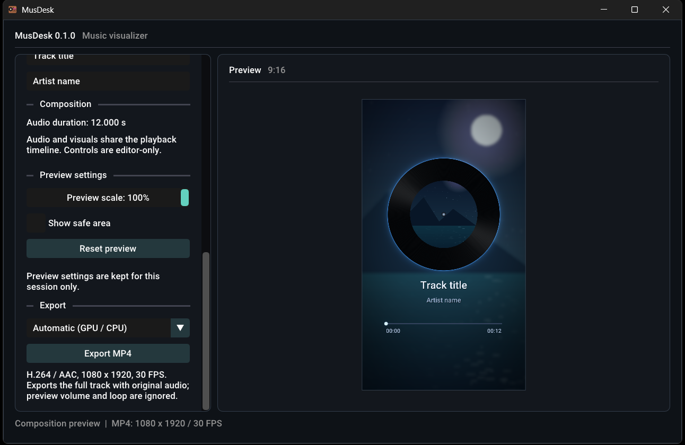

# MusDesk 0.1.0 screenshots

Application screenshots supplied for the MusDesk 0.1.0 documentation.
They show the composition workspace and MP4 export controls using the demo
artwork and synthesized audio produced by `scripts/GenerateDemo.ps1`.
The original PNG files are preserved without recompression.

